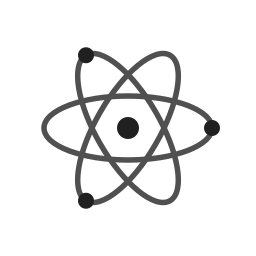
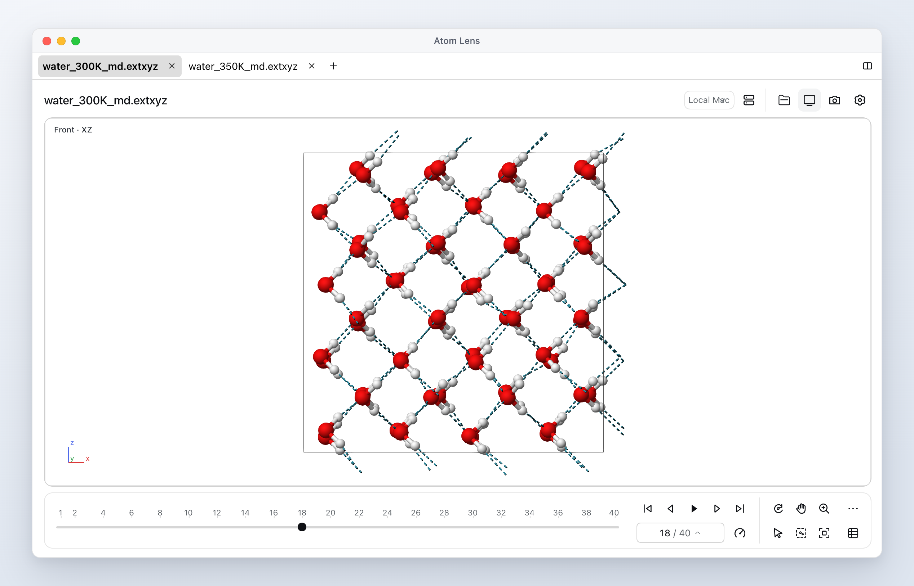
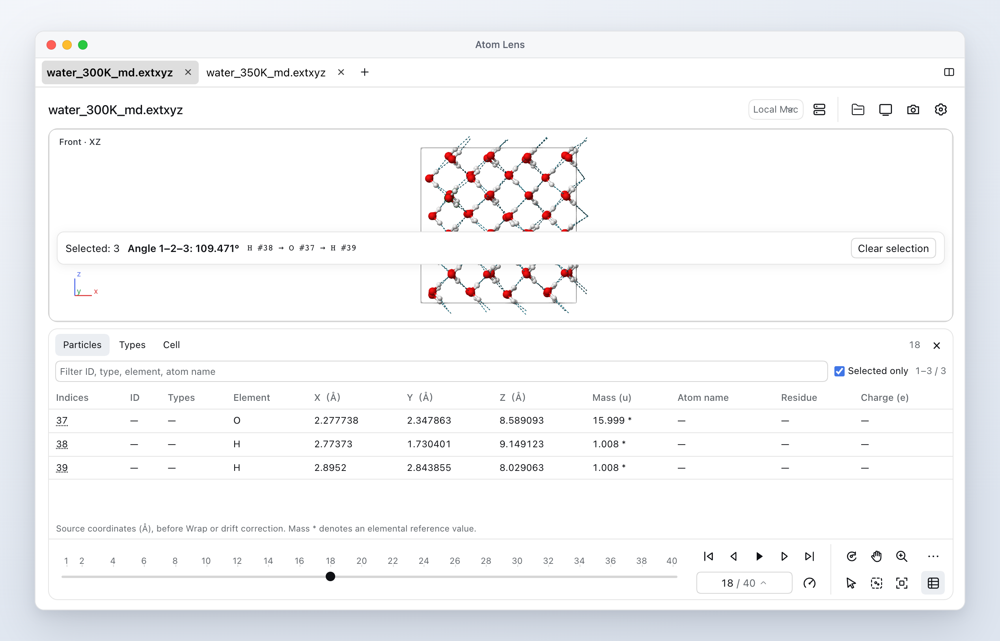
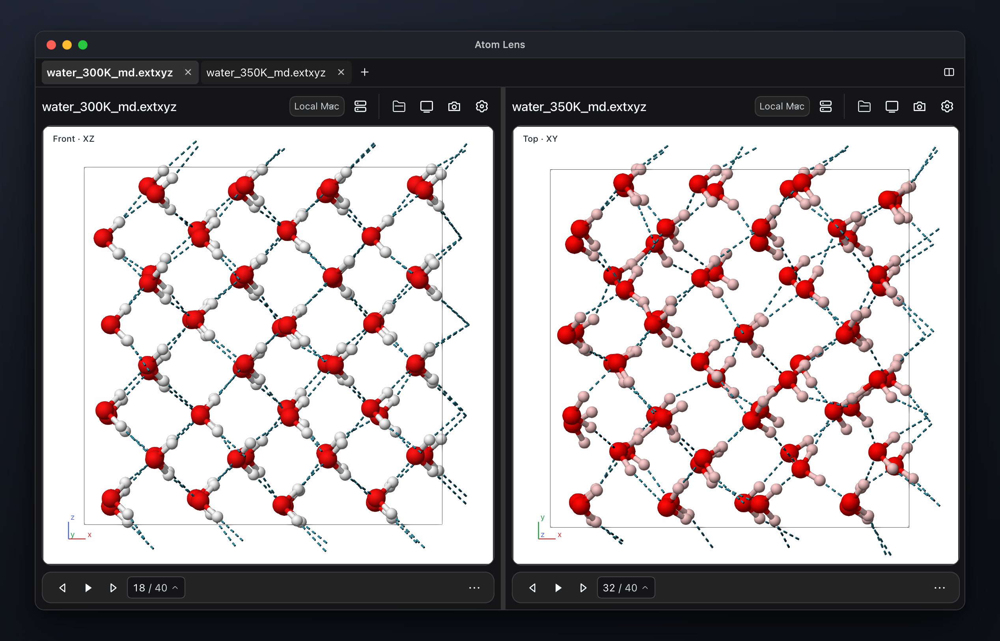
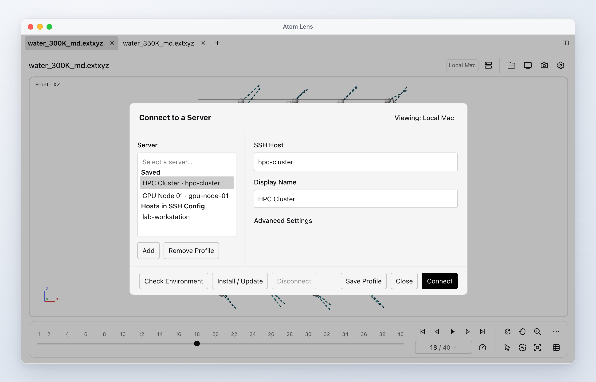
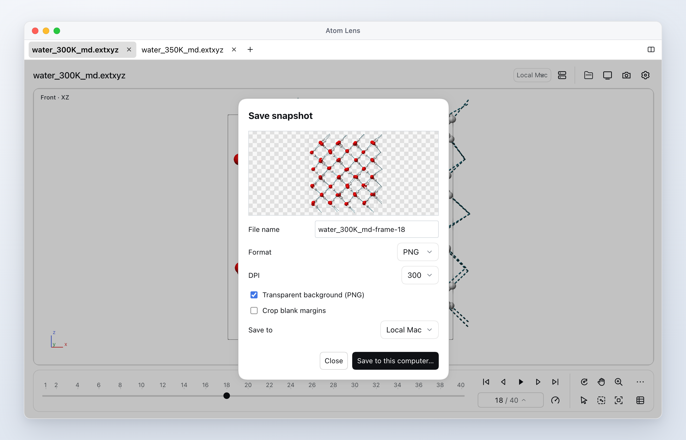

<p align="center">
  <picture>
    <source media="(prefers-color-scheme: dark)" srcset="design/atom-lens-dark.svg">
    
  </picture>
</p>

<h1 align="center">Atom Lens</h1>

<p align="center">
  <strong>Atomic structure and molecular dynamics trajectory viewer for macOS, Windows, and remote SSH servers.</strong><br>
  Standalone desktop apps include their runtime. A Codex sidebar plugin is also available.
</p>

<p align="center">
  <strong>English</strong> | <a href="README.zh-CN.md">简体中文</a> · <a href="https://chemcode-tju.github.io/atom-lens/">Interactive Feature Gallery ↗</a>
</p>

<p align="center">
  
</p>

---

## Core Features

- **Standalone Desktop Apps** — Runs on Apple Silicon (macOS 12+) and Windows 10/11 x64 (preview). Core formats require no local Python, conda, Git, or Codex. The macOS app can also install the optional Codex sidebar plugin.
- **Remote SSH Viewing** — Connect to Linux servers using your existing OpenSSH config (key/agent auth). The app uploads its lightweight backend over SSH (no server GitHub access or `sudo` needed), remembers multiple server profiles and last-opened directories, and streams frames on demand without downloading entire trajectories.
- **Tabs & Split Views** — Compare local and remote structures side-by-side or top-to-bottom, with independent camera, playback, and display states.
- **Multi-Format & Smart Directory Opening** — Open individual files or calculation directories directly. Automatically pairs trajectories with companion topology, cell, or metadata files (LAMMPS, CP2K, GROMACS) and opens original-name VASP files (`POSCAR`, `CONTCAR`, `XDATCAR`) without renaming.
- **Fast Streaming & Playback** — First-frame-first loading with parallel background indexing and on-demand frame fetching. Safely inspects growing, append-only trajectories within a fixed snapshot boundary. Supports up to 1,000,000 atoms per frame (tested on 158,559-atom GRO/TRR/XTC systems). Compact playback bar adjusts FPS, speed, stride, and loop on the fly, auto-collapsing to a single row in split or compact panes.
- **3D Visualization, Measurements & Structure Info** — Orthographic views (XY/XZ/YZ, single/dual/quad viewports), Jmol/RasMol/VESTA palettes, ball-and-stick & stick styles, unit cell display, atom indices, geometric H-bonds, PBC wrap, and mass-weighted COM drift correction. Includes click/box selection, distance/angle/dihedral measurements, per-element visibility & local styling, and a read-only **Structure Info** panel (Particles, Types, Cell).
- **Snapshot & Animation Export** — Export high-DPI **PNG** (with optional transparency), **JPEG**, and **PDF** snapshots, plus **GIF / MOV / MP4** animations (via FFmpeg). Save exports from both local and remote structures directly to your computer.
- **Bilingual UI & Themes** — Built-in English / Simplified Chinese interface with light, dark, and system themes.

## Feature Highlights

> Scroll horizontally to browse features; click any screenshot to view full size.

<table>
  <tr>
    <td align="center" valign="top">
      <a href="docs/images/features-inspect-display.png"></a><br>
      <strong>Selection, Measurements &amp; Structure Info</strong><br>
      <sub>Live distance / angle / dihedral HUD with searchable Particles, Types, and Cell tables.</sub>
    </td>
    <td align="center" valign="top">
      <a href="docs/images/features-split-dark.png"></a><br>
      <strong>Split Views &amp; Dark Theme</strong><br>
      <sub>Compare trajectories side-by-side with independent cameras and compact playback controls.</sub>
    </td>
    <td align="center" valign="top">
      <a href="docs/images/features-remote-ssh.png"></a><br>
      <strong>Remote SSH Server Manager</strong><br>
      <sub>Reuse OpenSSH config, deploy the backend over SSH without <code>sudo</code>, and stream frames on demand.</sub>
    </td>
    <td align="center" valign="top">
      <a href="docs/images/features-export.png"></a><br>
      <strong>Snapshot &amp; Animation Export</strong><br>
      <sub>Export high-DPI transparent PNG, JPEG, and PDF stills or GIF / MOV / MP4 animations.</sub>
    </td>
  </tr>
</table>

## Installation

### macOS App (Apple Silicon, macOS 12+)

1. Download the `.dmg` installer from [GitHub Releases](https://github.com/chemcode-tju/atom-lens/releases).
2. Open the DMG and drag **Atom Lens** into **Applications**.
3. Launch **Atom Lens** from Applications, then click **Open Local…** (or try [examples/water.xyz](examples/water.xyz)).
4. *(Optional)* To use Atom Lens in Codex chat, open **Codex Plugin → Install to Codex** inside the app and reopen your chat.

> **Note (`v0.0.0` preview):** This initial release is ad-hoc signed and not yet notarized by Apple. If macOS blocks launching it on first open, right-click **Atom Lens** in Applications and choose **Open**, allow it in **System Settings → Privacy & Security**, or run:
>
> ```sh
> xattr -dr com.apple.quarantine "/Applications/Atom Lens.app"
> ```
>
> Keep **Atom Lens** in Applications—it contains the bundled runtime.

### Windows App (Windows 10/11 x64, Preview)

Run the `*-Windows-x64-*-Setup.exe` preview installer, then launch **Atom Lens** from Start. Use **Ctrl+O** to open files or choose **Open local folder…** in the **Open and Connect** menu. For remote connections, enable Windows OpenSSH Client and set up key or agent authentication. Local animation export uses FFmpeg on your PATH.

See [build instructions](docs/development.md#windows-打包) for producing the unsigned preview installer.

### Remote Linux Servers (via SSH)

1. In **Atom Lens**, open **Servers** and select an SSH host from your config (or add one with a custom Python path).
2. Click **Install / Update** to upload the backend over SSH (requires Python 3.9+ and working SSH key/agent login on the server).
3. Click **Connect** to browse remote directories and stream trajectories directly.
4. *(Optional)* Check **Also install Codex plugin on server** if you also want the sidebar viewer in remote Codex SSH sessions.

### From Source (Optional / Server CLI)

```sh
git clone https://github.com/chemcode-tju/atom-lens.git
cd atom-lens
python3 install.py
```

## Supported Formats & Optional Dependencies

| Formats / Features | Extra Dependency |
| --- | --- |
| XYZ / extxyz, VASP (`POSCAR` / `CONTCAR` / `XDATCAR`), ASE `.traj`, LAMMPS text `dump` (+ `data` / input / `log`), GROMACS `.gro` & `.xtc`, CP2K `.xyz` + `.cell` | None (built-in) |
| CIF, PDB, standalone LAMMPS `data` | `ase` |
| GROMACS `GRO + TOP/ITP` (or `XTC + GRO + TOP`) | `MDAnalysis` (+ GROMACS library / `GMXLIB` for standard force fields) |
| GROMACS `TRR + TPR` / `XTC + TPR` | `GROMACS` (compatible with the TPR version) |
| Animation export (`GIF` / `MOV` / `MP4`) | `FFmpeg` |

Install optional dependencies on the host that reads/encodes the files (for remote SSH servers, set the target Python path in the **Servers** panel; for source/Codex installs, activate your conda environment before running `python install.py`).

## Documentation

Detailed guides (currently in Chinese):

- [Standalone Mac App & Remote SSH](docs/desktop.md)
- [Usage Guide & FAQ](docs/usage.md)
- [Installation, Dependencies & Uninstall](docs/installation.md)
- [Development & Architecture](docs/development.md) · [macOS Packaging](docs/macos-release.md) · [Changelog](CHANGELOG.md)

## License

Source code is licensed under the [MIT License](LICENSE). Third-party licenses: [3Dmol.js](plugin/web/vendor/LICENSE-3Dmol.txt), [Mol* XTC decoder (MIT)](plugin/web/vendor/LICENSE-Molstar.txt).
