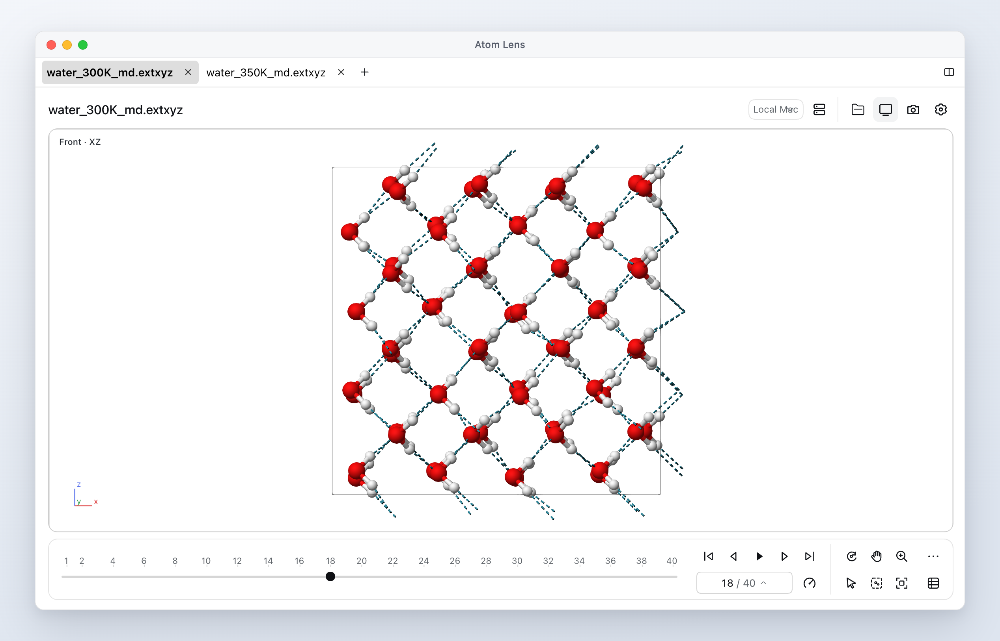
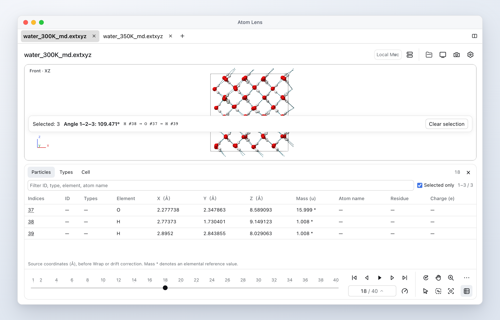
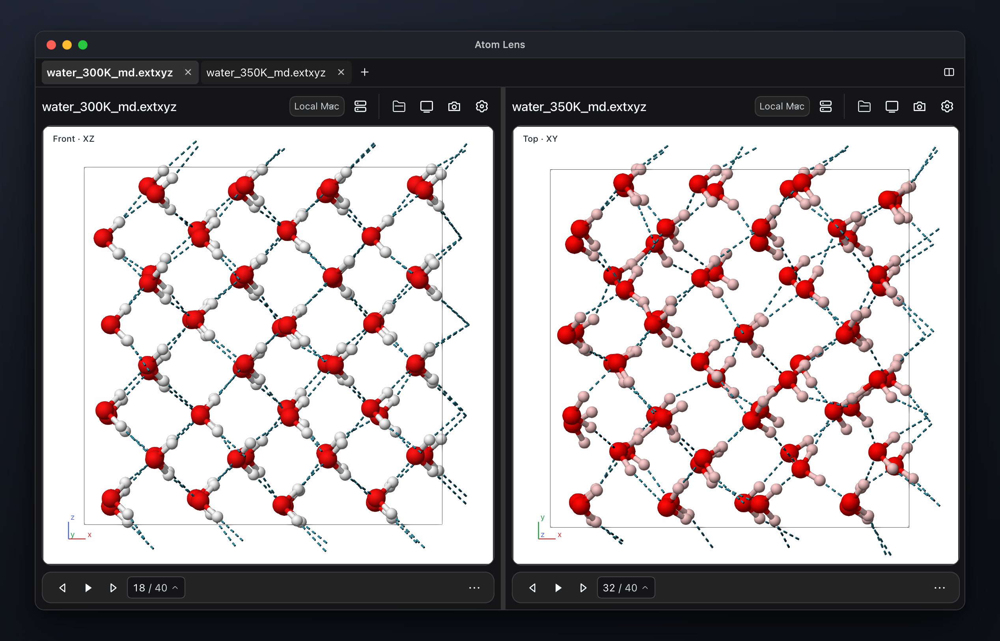
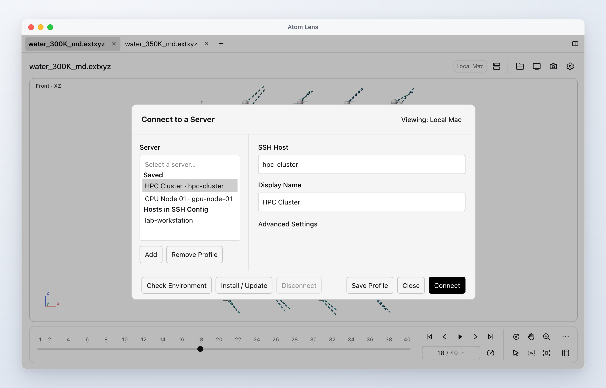
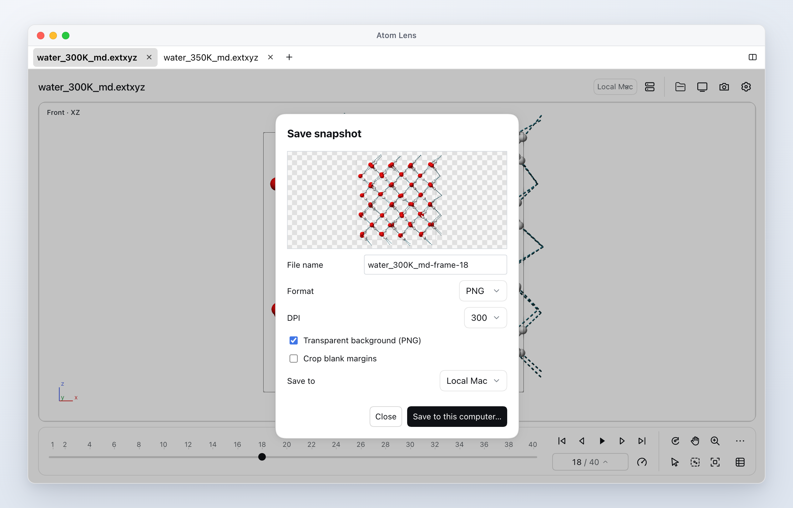

<p align="center">
  <picture>
    <source media="(prefers-color-scheme: dark)" srcset="design/atom-lens-dark.svg">
    
  </picture>
</p>

<h1 align="center">Atom Lens</h1>

<p align="center">
  <strong>面向 macOS、Windows 与远程 SSH 服务器的原子结构与分子动力学轨迹查看器。</strong><br>
  独立桌面版内置运行环境，也可通过 Codex 聊天侧栏使用查看器。
</p>

<p align="center">
  <a href="README.md">English</a> | <strong>简体中文</strong> · <a href="https://liyang-tju.github.io/atom-lens/?lang=zh">交互式功能轮播预览 ↗</a>
</p>

<p align="center">
  
</p>

---

## 核心功能

- **独立桌面 App** — 支持 Apple Silicon（macOS 12+）和 Windows 10/11 x64（预览版）。常用结构与轨迹格式无需安装 Python、conda、Git 或 Codex。macOS App 内可安装 Codex 侧栏插件。
- **远程 SSH 直连查看** — 读取本机 OpenSSH 配置（密钥／agent 登录），通过 SSH 上传轻量后端（服务器无需访问 GitHub，也无需 `sudo`）。支持保存多台服务器配置、按主机记住上次打开的目录，轨迹按需逐帧读取，无需整文件下载。
- **多标签页与分屏对比** — 支持同时打开多个结构标签页，任选两个结构左右或上下分屏对比，本地与远程服务器结构可同屏显示，各自保留独立的视角、播放进度和显示设置。
- **多格式支持与计算目录自动识别** — 支持单文件或直接打开计算目录，自动配对轨迹与配套拓扑／晶胞／元数据文件（LAMMPS、CP2K、GROMACS），并支持原名打开 VASP 文件（`POSCAR`、`CONTCAR`、`XDATCAR`）而无需改后缀。
- **大轨迹流式加载与流畅播放** — 首帧优先显示，后台索引与前台取帧并行推进；采用有界 LRU 缓存按需读帧，并支持安全查看正在追加写入的运行中轨迹。每帧保护上限达 1,000,000 原子（已实测 158,559 原子 GRO／TRR／XTC 体系）。紧凑底栏支持实时调整帧率、倍速、步长与循环，分屏或矮窗格自动切换单行模式。
- **三维可视化、几何测量与结构信息** — 提供正交多视角（XY／XZ／YZ 及单／双／四视图）、Jmol／RasMol／VESTA 配色、球棍／线棒样式、晶胞框、原子序号、几何氢键、周期性 Wrap 与质量加权质心漂移校正；支持点选／框选、距离／夹角／二面角测量、按元素显隐与局部样式，以及只读 **结构信息** 面板（粒子、类型、晶胞）。
- **快照与动画导出** — 支持导出高 DPI 的 **PNG**（可选透明背景）、**JPEG**、**PDF** 快照，以及 **GIF／MOV／MP4** 轨迹动画（需 FFmpeg）。独立 App 可将本地或远程结构的导出结果保存到当前电脑。
- **双语界面与主题** — 内置英文／简体中文切换，支持跟随系统、浅色和深色主题。

## 功能预览

> 可左右滑动浏览各项功能，点击任意截图查看大图。

<table>
  <tr>
    <td align="center" valign="top">
      <a href="docs/images/features-inspect-display.png"></a><br>
      <strong>原子选择、几何测量与结构信息</strong><br>
      <sub>实时测量距离、键角与二面角，联动可筛选的粒子、类型与晶胞只读面板。</sub>
    </td>
    <td align="center" valign="top">
      <a href="docs/images/features-split-dark.png"></a><br>
      <strong>多标签分屏对比与深色主题</strong><br>
      <sub>并排对比不同轨迹与视角，独立控制相机，自动切换紧凑单行播放栏。</sub>
    </td>
    <td align="center" valign="top">
      <a href="docs/images/features-remote-ssh.png"></a><br>
      <strong>远程 SSH 服务器管理</strong><br>
      <sub>复用本机 OpenSSH 配置，免 <code>sudo</code> 一键部署轻量后端，按需流式读取远端轨迹。</sub>
    </td>
    <td align="center" valign="top">
      <a href="docs/images/features-export.png"></a><br>
      <strong>高清快照与动画导出</strong><br>
      <sub>实时预览并导出高 DPI 透明 PNG、JPEG、PDF 快照或 GIF／MOV／MP4 动画。</sub>
    </td>
  </tr>
</table>

## 快速安装

### macOS 独立 App（Apple Silicon，macOS 12+）

1. 从 [GitHub Releases](https://github.com/liyang-tju/atom-lens/releases) 下载 `.dmg` 安装包。
2. 双击打开 DMG，将 **Atom Lens** 拖入 **Applications**。
3. 从 Applications 启动 **Atom Lens**，点击 **“打开本地…”** 打开结构文件（可先用 [examples/water.xyz](examples/water.xyz) 体验）。
4. *（可选）* 如需在 Codex 聊天侧栏使用，在 App 内点击 **“Codex 插件” → “安装到 Codex”**，完成后重新打开聊天即可。

> **说明（`v0.0.0` 预览版）：** 当前安装包采用本地 ad-hoc 签名，尚未经过 Apple 公证。首次打开若遇 macOS 安全拦截，请在 Applications 中右键 **Atom Lens** 选择 **“打开”**，或在 **系统设置 → 隐私与安全性** 中允许运行；也可以在终端执行：
>
> ```sh
> xattr -dr com.apple.quarantine "/Applications/Atom Lens.app"
> ```
>
> 请保留 Applications 中的 **Atom Lens**，其内置了应用运行环境。

### Windows 独立 App（Windows 10/11 x64，预览版）

运行 `*-Windows-x64-*-Setup.exe`，然后从开始菜单启动 **Atom Lens**。用 **Ctrl+O** 打开文件，或从 **打开与连接** 菜单打开本地目录。连接服务器需启用 Windows OpenSSH 客户端并配置密钥或 SSH agent。本地动画导出需将 FFmpeg 加入 PATH。

未签名的预览安装包可按[构建说明](docs/development.md#windows-打包)生成。

### 远程 Linux 服务器（通过 SSH）

1. 在 **Atom Lens** 中打开 **“服务器”**，从已有 SSH 配置选择主机（或新增配置并指定 Python 路径）。
2. 点击 **“安装／更新”** 通过 SSH 上传后端（服务器需有 Python 3.9+ 且已配置 SSH 密钥／agent 登录）。
3. 点击 **“连接”** 即可浏览服务器目录并按需读取轨迹。
4. *（可选）* 如需同时在远程 Codex 聊天中使用，安装时勾选 **“同时安装到服务器的 Codex”**。

### 源码安装（可选／服务器命令行）

```sh
git clone https://github.com/liyang-tju/atom-lens.git
cd atom-lens
python3 install.py
```

## 支持格式与可选依赖

| 格式／功能 | 额外依赖 |
| --- | --- |
| XYZ / extxyz、VASP（`POSCAR` / `CONTCAR` / `XDATCAR`）、ASE `.traj`、LAMMPS 文本 `dump`（含 `data` / input / `log`）、GROMACS `.gro` 与 `.xtc`、CP2K `.xyz` + `.cell` | 无（内置） |
| CIF、PDB、单独的 LAMMPS `data` | `ase` |
| GROMACS `GRO + TOP/ITP`（或 `XTC + GRO + TOP`） | `MDAnalysis`（标准力场另需 GROMACS 库或 `GMXLIB`） |
| GROMACS `TRR + TPR` / `XTC + TPR` | `GROMACS`（需兼容生成该 TPR 的版本） |
| 动画导出（`GIF` / `MOV` / `MP4`） | `FFmpeg` |

可选依赖只需安装在**读取或编码文件的主机**上（远程 SSH 服务器可在 **“服务器”** 面板填写对应 Python 路径；源码／Codex 模式可在激活目标 conda 环境后运行 `python install.py`）。

## 详细文档

- [独立 App 与远程 SSH 连接](docs/desktop.md)
- [完整使用手册与常见问题](docs/usage.md)
- [安装、可选依赖与卸载说明](docs/installation.md)
- [开发与仓库结构](docs/development.md) · [Mac 打包说明](docs/macos-release.md) · [更新记录](CHANGELOG.md)

## 许可证

源码采用 [MIT 许可证](LICENSE)。内置第三方组件许可见 [3Dmol.js](plugin/web/vendor/LICENSE-3Dmol.txt) 与 [Mol* XTC 解码器（MIT）](plugin/web/vendor/LICENSE-Molstar.txt)。
