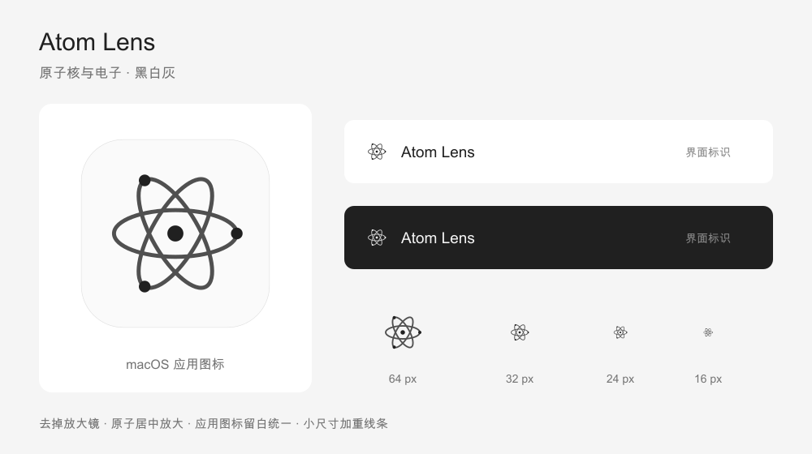

# Atom Lens 图标

[返回项目 README](../README.md)

沿用 **A · 经典原子** 的内部图形，移除整个放大镜，只保留原子核、三条电子轨道和三个电子。原子放大并居中，配色仅为黑白灰。

当前资产：

- [主图标 SVG](atom-lens.svg) · [透明 PNG](atom-lens.png)
- [深色界面 SVG](atom-lens-dark.svg)
- [Mac 应用图标 SVG](app-icon.svg) · [1024 px PNG](app-icon.png)
- [小尺寸应用图标 SVG](app-icon-small.svg) · [PNG](app-icon-small.png)
- [修订预览 SVG](refined-preview.svg)

主图标 viewBox 为 256×256；原子轨道长半轴 84、短半轴 32、线宽 5.5，原子核半径 11、电子半径 8。

Mac 图标使用 1024×1024 画布，底板为居中的 824×824，每侧留白 100；原子可见宽度约为底板的 71%。16/32 pt 的 ICNS 图层使用线宽 7.5 的加重版本。App 顶栏标识为 24×24，随浅色／深色界面使用当前文字颜色；插件安装窗口使用等比例缩放的 96×96 应用图标。

源文件保持可编辑，PNG 由 Inkscape 渲染。修改图形参数后执行 `python3 design/render_icons.py`，再构建 DMG。此前三个候选保留在 `atomlens-a/b/c` 与 [comparison.svg](comparison.svg) 中供比较，不作为当前正式资产。
